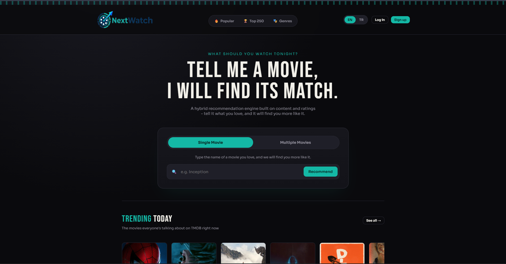
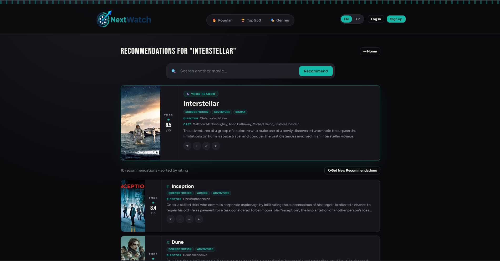

<p align="center">
  
</p>

<p align="center">
  Content-based movie recommendation web app built with Flask, MySQL and scikit-learn, using TMDB data.
</p>

<p align="center">
  <a href="https://film-recommendation-system-production-29d8.up.railway.app/"><b>Live demo</b></a>
</p>

<p align="center">
  
  
  
  
  <a href="LICENSE"></a>
</p>

NextWatch is a movie recommendation site. You search for one movie (or pick a few) and it returns a ranked list of similar movies with genres, cast, director and posters from [TMDB](https://www.themoviedb.org/).

The recommendations are computed in the app itself, without an external recommendation API. Similarity is based on four signals: plot, keywords, genre and people (cast/director). Each one uses TF-IDF and cosine similarity, and they are combined with fixed weights. The final list is then re-ranked with a Bayesian rating, so a movie with a few 10/10 votes does not rank above a well-known movie with thousands of good ratings. The site also has a Top 250 page, genre pages, filmography pages for actors and directors, and it works in both English and Turkish.

<table>
  <tr>
    <td></td>
    <td></td>
  </tr>
  <tr>
    <td align="center"><sub>Home page: search, single/multi-movie mode, Trending Today</sub></td>
    <td align="center"><sub>Recommendations for <i>Interstellar</i></sub></td>
  </tr>
</table>

## Features

- **Single or multi-movie recommendations.** Search one movie, or pick 2-5 movies and get one list based on all of them.
- **Search as you type.** Titles that start with the query are shown before titles that only contain it. Search also checks Turkish titles, so "Dövüş Kulübü" finds *Fight Club*.
- **Top 250 and genre pages**, sorted by the same Bayesian rating used by the recommender instead of the plain average rating.
- **Clickable cast, directors and genres.** Clicking a name or genre opens a page with that person's movies or that genre.
- **English/Turkish switch** for titles, overviews and genre names. Movies without a translation are shown in English.
- **User accounts** with favourites (up to 5), a watchlist, a watched list and 1-10 ratings.
- **Trending Today** section, updated every day from TMDB's trending list.
- **Basic security:** rate limits on login/register, secure session cookies, and password rules checked on both frontend and backend.

## How the recommendations work

The engine does not merge all movie fields into one text. It computes four separate similarity scores and combines them with weights. The weights are defined as `TEXT_WEIGHT`, `KEYWORD_WEIGHT`, `GENRE_WEIGHT` and `PEOPLE_WEIGHT` at the top of `recommend/engine.py`.

| Signal | What it compares | Why it is separate |
|---|---|---|
| Text (45%) | TF-IDF + cosine similarity on the overview | Best match for the general feel of the story |
| Keywords (25%) | TMDB keyword tags (e.g. "time travel") | More specific than genre |
| Genre (20%) | Genre tags | Broad category match |
| People (10%) | Director and cast names | Movies from the same director or actors |

Each signal gives an N×N similarity matrix, and the weighted sum is the final similarity score. First a shortlist of the most similar movies is selected with this score. Then the shortlist is re-ranked with a Bayesian weighted rating (similar to IMDb's). The rating is only used inside the shortlist, so a popular but unrelated movie cannot push out a similar one. Without this step the app kept recommending the same popular movies.

Top 250, genre pages (`lists/movies_lists.py`) and filmographies (`lists/people_lists.py`) use the same cached data. They are just different filters and sorts, not separate models.

## English/Turkish support

Each movie can have a Turkish title and overview (`title_tr`, `overview_tr` in `movies`, and `name_tr` in `genres`, see `db/schema.sql`). These are filled by `data/fetch_translations.py`.

- **Search checks both languages** no matter which language is selected. `/api/search` matches the query against `title` or `title_tr`.
- **The language switch** in the header (`state.lang` in `templates/index.html`) decides which column is shown. If a movie has no translation, the SQL query returns the English one (`COALESCE(title_tr, title)` in `recommend/engine.py`), so the frontend does not need its own fallback.

## Tech stack

| Layer          | Tools |
|----------------|-------|
| Backend        | Python, Flask, gunicorn |
| Database       | MySQL |
| Recommendation | pandas, scikit-learn (TF-IDF + cosine similarity) |
| Frontend       | HTML, CSS, JavaScript (no framework) |
| Data source    | [TMDB API](https://www.themoviedb.org/documentation/api) |
| Deployment     | Railway (web service + a second service for the daily refresh) |

## API

The frontend uses a JSON API. All routes are in `main.py`.

| Method | Endpoint | Description |
|---|---|---|
| `GET` | `/api/search?q=` | Search English and Turkish titles |
| `GET` | `/api/recommend?title=&top_n=` | Recommendations for one movie |
| `POST` | `/api/recommend_multi` | Recommendations for 2-5 movies (`{"titles": [...]}`) |
| `GET` | `/api/movie/<id>` | Details of one movie |
| `GET` | `/api/top250` · `/api/genres` · `/api/genre/<name>` | Top 250, genre list, movies by genre |
| `GET` | `/api/cast/<name>` · `/api/director/<name>` | Filmography of a person |
| `GET` | `/api/popular` · `/api/popular/all` | Trending Today (cached for 24h) |
| `POST` | `/api/register` · `/api/login` · `/api/logout` | Authentication (login and register are rate-limited) |
| `GET` | `/api/watchlist` · `/api/watched` · `/api/favourites` · `/api/ratings` | User lists and ratings (login required) |
| `POST/DELETE` | `/api/watchlist/<id>` · `/api/watched/<id>` · `/api/favourites/<id>` · `/api/rating/<id>` | Add or remove a movie or rating (login required) |

## Project structure

```
.
├── main.py                         # Flask app, all /api/... routes
├── refresh_daily_popular_movies.py # separate process that updates "Trending Today" (see Deployment)
├── config.py                       # loads .env, sets up the DB connection pool
├── requirements.txt
├── db/
│   └── schema.sql                  # creates the database and tables
├── data/
│   ├── fetch_movies.py             # bulk import from TMDB
│   ├── fetch_daily_popular_movies.py  # TMDB fetch and DB code for the daily refresh
│   └── fetch_translations.py       # Turkish titles, overviews and genre names (safe to re-run)
├── recommend/
│   └── engine.py                   # recommendation model
├── lists/
│   ├── movies_lists.py             # Top 250 and genre queries
│   └── people_lists.py             # actor/director filmography queries
├── user/
│   └── auth.py                     # accounts, favourites, watchlist, watched, ratings
├── static/images/                  # logo and favicons
└── templates/index.html            # the whole frontend (HTML + CSS + JS in one file)
```

## Running locally

You need Python 3.10+, MySQL 8.0+ and a free [TMDB API key](https://www.themoviedb.org/settings/api).

```bash
# 1. Clone and install
git clone https://github.com/yavuzkrm/Full-stack-content-based-movie-recommendation-system
cd Full-stack-content-based-movie-recommendation-system
python3 -m venv .venv && source .venv/bin/activate   # Windows: .venv\Scripts\Activate.ps1
pip install -r requirements.txt

# 2. Configure
cp .env.example .env   # fill in TMDB_API_KEY, MySQL credentials and a random SECRET_KEY
                        # (generate one with: python3 -c "import secrets; print(secrets.token_hex(32))")

# 3. Create the database (MySQL must be running)
mysql -u root -p < db/schema.sql

# 4. Import movies from TMDB (slow because of TMDB rate limits)
python -m data.fetch_movies

# 5. Fetch Turkish titles, overviews and genre names
python -m data.fetch_translations

# 6. Start the app
gunicorn main:app --reload
```

Open http://localhost:8000. The first request builds the similarity model, so it takes a bit longer. This happens once per process start.

On Windows gunicorn does not work, so use Flask's dev server: `flask --app main run --debug`, then open http://localhost:5000.

Keep `APP_ENV=development` in your local `.env`. Without it the login cookie is HTTPS-only and login will not work on `http://localhost`. Do not set it in production (see [Deployment](#deployment)).

<details>
<summary><b>Troubleshooting</b></summary>

- **`mysql: command not found`**: the MySQL client is not on your PATH. Use the full path (e.g. `/usr/local/mysql/bin/mysql` on macOS) or add it to PATH.
- **`Access denied for user 'root'@'localhost'`**: `MYSQLPASSWORD` in `.env` is not your MySQL root password.
- **`gunicorn: command not found`**: the virtual environment is not active, or `pip install -r requirements.txt` failed. Check its output.
- **Search or recommendations return nothing**: step 4 is not finished yet. Check the row count: `mysql -u root -p -e "SELECT COUNT(*) FROM film_oneri.movies;"`.
- **`Could not connect to the database` on startup**: MySQL is not running. Start it (`mysql.server start` on macOS, `sudo systemctl start mysql` on Linux).
- **You are logged out right after logging in**: set `APP_ENV=development` in `.env` (see above).

</details>

## Deployment

In production, run without `--reload`:

```bash
gunicorn main:app
```

Do not set `APP_ENV` in production (or set it to `production`), so the login cookie requires HTTPS. Also make sure `SECRET_KEY` is a real random value and not the placeholder from `.env.example`.

Gunicorn can start several worker processes, and each one imports `main.py`. A scheduler inside `main.py` would therefore run once per worker. For this reason the daily "Trending Today" update is a separate script that runs as a second, always-on service (for example a second service in the same Railway project):

```bash
python refresh_daily_popular_movies.py
```

It updates the list once at startup and then every 24 hours, so the section is not empty after a deploy. A cron job service is not a good fit, because those expect the command to finish. If this service stops, the site still works but "Trending Today" is no longer updated and no error is shown, so it is worth checking it from time to time.

## Notes

- The recommendation model, the search index and the "Trending Today" cache are kept in memory and rebuilt when the server restarts.
- Missing data does not break the engine. If a movie has no keywords yet, that signal just adds nothing for it. Movies without a translation are shown in English.
- `/api/login` and `/api/register` are rate-limited per IP (10/min and 10/hour). If you run multiple instances, set flask-limiter's `storage_uri` to Redis instead of the default in-memory storage.

## License

[MIT](LICENSE). Movie data and images come from [TMDB](https://www.themoviedb.org/). This product uses the TMDB API but is not endorsed or certified by TMDB.
